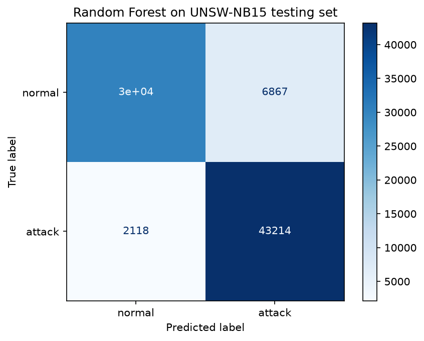

# IDS Feature Pipeline

An end-to-end network intrusion detection pipeline in Python: it captures traffic with Wireshark, extracts per-packet and per-flow features with Scapy and Pandas, and trains machine learning classifiers on the official UNSW-NB15 dataset. The project also tests how well a model trained on a 2015 lab dataset transfers to a modern home-network capture, and documents where it fails.

## Pipeline

```
Wireshark capture (.pcapng)
        |
        v
packets.py   -> per-packet features (time, IPs, ports, protocol, length, TTL, TCP flags)
        |
        v
flows.py     -> bidirectional flows with UNSW-NB15-compatible features
        |
        v
train.py     -> Random Forest (supervised) + Isolation Forest (unsupervised)
        |
        v
scores UNSW-NB15 test set and own captured flows
```

## Repository layout

```
src/ids/packets.py        packet-level feature extraction (Scapy)
src/ids/flows.py          bidirectional flow builder, UNSW-compatible features
src/ids/flows_v1.py       first one-direction flow version (kept for history)
src/ids/train.py          model training, evaluation, scoring of own capture
src/ids/ablation.py       TTL ablation experiment
src/ids/ablation2.py      flow-size and timing ablation experiment
src/ids/compare.py        feature medians: UNSW vs own flows
src/ids/compare_matched.py  same comparison on flows of matched size
docs/project_log.md       decisions, results and limitations
docs/confusion_matrix_rf.png
data/                     datasets and captures (not committed)
models/                   trained model (not committed)
```

## Setup

Requires Python 3.13 (Python 3.15 lacked prebuilt wheels for some dependencies at the time of writing).

```
python -m venv .venv
.venv\Scripts\activate
pip install -r requirements.txt
```

Datasets are not included in the repository. Download the official UNSW-NB15 training and testing sets from UNSW Canberra (https://research.unsw.edu.au/projects/unsw-nb15-dataset), place `UNSW_NB15_training-set.csv` and `UNSW_NB15_testing-set.csv` in `data/`, and put your own capture in `data/sample.pcapng`.

## Usage

Run from the project root, in this order:

```
python src\ids\packets.py     # sample.pcapng -> data/packet_features.csv
python src\ids\flows.py       # packets -> data/flows.csv
python src\ids\train.py       # trains, evaluates, scores your flows
```

## Methodology

- **Flows:** packets are grouped by a direction-independent key (both endpoints and protocol). The sender of the first packet defines the forward direction. A flow ends after 120 seconds of silence.
- **Features (14 plus protocol):** duration, packets and bytes per direction, mean packet length, TTL, inter-arrival time, rate, and load, named to match UNSW-NB15 columns so a model trained on UNSW can score our flows.
- **Models:** Random Forest (200 trees, balanced class weights) trained on the official training set, and Isolation Forest trained on normal flows only.
- **Evaluation:** official UNSW-NB15 training and testing partitions (175,341 and 82,332 flows).

## Results

| Model | Accuracy | Attack recall | Normal recall |
|---|---|---|---|
| Random Forest | 89.1% | 95.3% | 81.4% |
| Isolation Forest | 60.9% | 39.3% | 87.4% |

Random Forest confusion matrix (rows: true class, columns: predicted):

|  | Predicted normal | Predicted attack |
|---|---|---|
| **Normal** | 30,133 | 6,867 |
| **Attack** | 2,118 | 43,214 |



Supervised learning clearly outperforms the unsupervised model, which only learns what normal traffic looks like and misses most attacks that resemble it.

## Findings on own capture

The trained model was applied to 580 flows from an ordinary home Wi-Fi capture (browsing, video, DNS). It flagged 544 to 556 of them as attacks depending on the feature set, even though the traffic is normal. Experiments in `docs/project_log.md` narrow down why:

- **TTL ruled out.** Removing TTL features changed UNSW accuracy by 0.3 points and left the flagged count unchanged.
- **Tiny flows.** 92.4% of UNSW training flows with two packets or fewer are attacks, while 51% of our flows are that small (DNS and QUIC), so the model labels them as attacks.
- **Packet size.** At matched flow sizes, our flows carry 4 to 12 times more bytes per packet than UNSW normal flows. Modern encrypted traffic sends large packets (median packet 1,292 bytes, consistent with QUIC), unlike the 2015 lab traffic. A small share comes from capture offload artifacts.
- **Timing** differs by about 5x at most and is not the main cause.

## Limitations

- The own capture is unlabeled normal traffic, so detection performance on real traffic cannot be measured yet.
- UNSW-NB15 features were generated with Argus and Bro; the Scapy features here approximate them, and byte and timing definitions may differ.
- Domain shift: UNSW-NB15 was generated in a 2015 lab network, and our capture is a modern internet connection.
- UNSW-NB15 is about 55% attack traffic, far from real networks, and tiny flows are overwhelmingly attacks in the data.
- Scores are on a single dataset and not comparable to results from other datasets.

## Ethics

Capture traffic only on networks you own or have explicit permission to monitor. Captures contain IP addresses and browsing metadata, so they are excluded from the repository (`.gitignore`).

## Roadmap

- Generate labeled attack traffic (port scans, SYN floods) in a VM lab, and evaluate on real captures.
- Compute training features with the same tooling as the captured traffic, to remove definition mismatch.
- Add unit tests and continuous integration.

## References

- Moustafa, N. and Slay, J. "UNSW-NB15: a comprehensive data set for network intrusion detection systems (UNSW-NB15 network data set)." Military Communications and Information Systems Conference (MilCIS), 2015.
- Moustafa, N. and Slay, J. "The evaluation of Network Anomaly Detection Systems: Statistical analysis of the UNSW-NB15 dataset and the comparison with the KDD99 dataset." Information Security Journal: A Global Perspective, 2016.